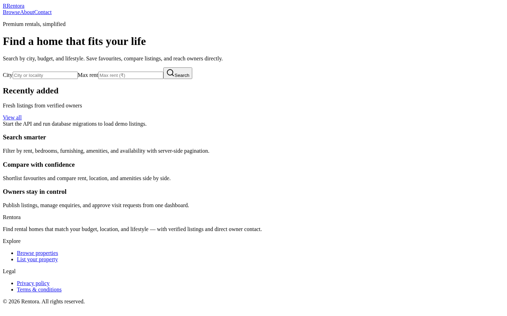
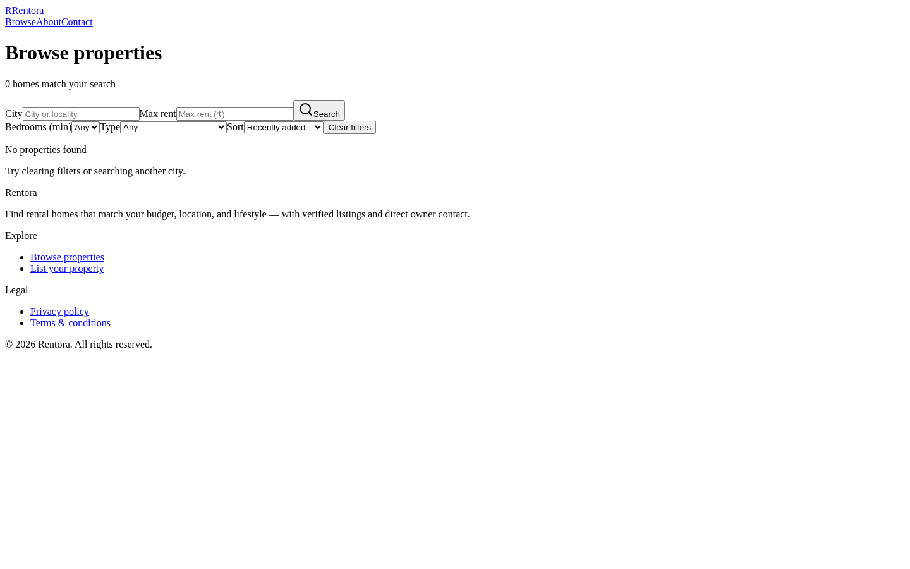
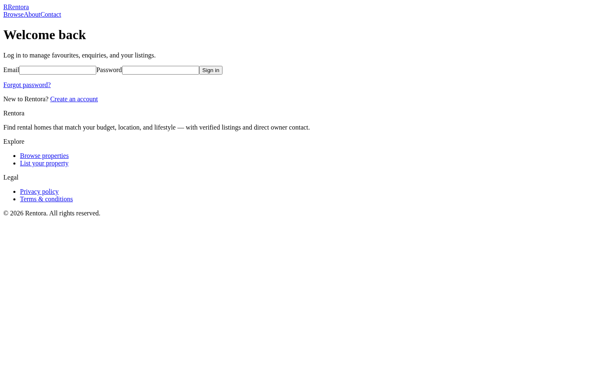
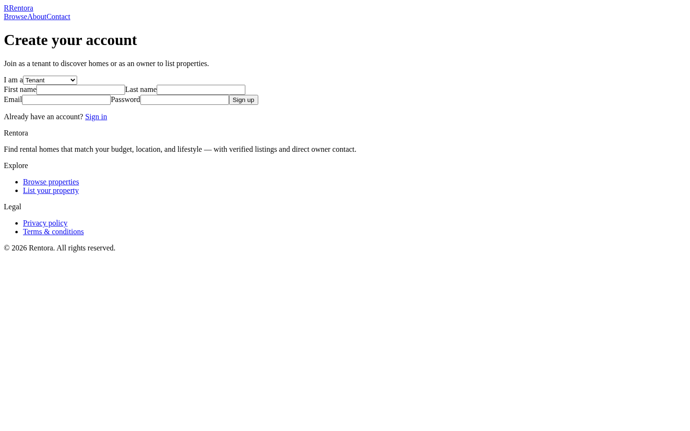
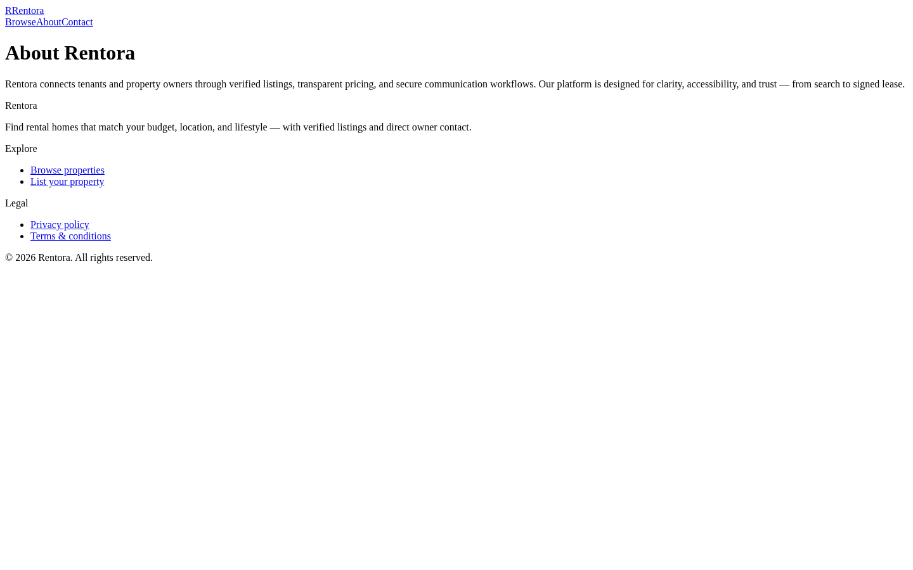

# Rentora

Modern property rental portal — tenants discover homes, owners manage listings, and administrators moderate the platform.

## Screenshots

| Home | Browse properties |
|------|-------------------|
|  |  |

| Sign in | Sign up |
|---------|---------|
|  |  |



## Repository

This project is a **pnpm monorepo** on branch `main`. Secrets stay local: copy `apps/api/.env.example` → `apps/api/.env` (never commit `.env`).

**Push to GitHub (after creating an empty repo named `rentora`):**

```bash
git remote add origin https://github.com/prasadp1307/Rentora.git
git push -u origin main
```

## Clone & run

```bash
git clone https://github.com/prasadp1307/Rentora.git
cd rentora
pnpm install
cp apps/api/.env.example apps/api/.env
cp apps/web/.env.example apps/web/.env.local
# Set DATABASE_URL, then:
pnpm db:generate && pnpm db:migrate && pnpm db:seed
pnpm dev
```

## Stack

- **Frontend:** Next.js (App Router), TypeScript, Tailwind CSS, TanStack Query, React Hook Form, Zod
- **Backend:** NestJS, Prisma, PostgreSQL, Redis (optional), S3-compatible storage
- **Shared:** `@rentora/shared` validation schemas

## Prerequisites

- Node.js 20+
- pnpm 9+
- PostgreSQL 16+ (local or Docker)

## Quick start

```bash
pnpm install

# Optional: start Postgres/Redis/MinIO (requires Docker Hub access)
pnpm docker:up

# Configure API
cp apps/api/.env.example apps/api/.env
# Edit DATABASE_URL if not using Docker defaults

# Database
pnpm db:generate
pnpm db:migrate   # applies prisma/migrations
pnpm db:seed

# Development (two terminals or parallel)
pnpm dev:api
pnpm dev:web
```

- Web: http://localhost:3000  
- API: http://localhost:4000/api/v1  
- Swagger: http://localhost:4000/docs  

### Demo accounts (after seed)

| Role   | Email                 | Password     |
|--------|-----------------------|--------------|
| Admin  | admin@rentora.local   | Password1!   |
| Owner  | owner@rentora.local   | Password1!   |
| Tenant | tenant@rentora.local  | Password1!   |

Email verification links are printed to the API console in development.

## Scripts

| Command | Description |
|---------|-------------|
| `pnpm dev` | Run web + API in parallel |
| `pnpm build` | Build all packages |
| `pnpm test` | Run tests |
| `pnpm docker:up` / `docker:down` | Local infrastructure |

## Project structure

```
apps/web          Next.js frontend
apps/api          NestJS backend + Prisma
packages/shared   Shared types/schemas
infrastructure/   docker-compose.yml
docs/             Architecture & feature status
```

## Testing

```bash
pnpm --filter @rentora/api test
```

CI runs migrations against PostgreSQL, API tests, and production builds (see `.github/workflows/ci.yml`).

## Documentation

- [Architecture](docs/ARCHITECTURE.md)
- [Features & limitations](docs/FEATURES.md)

## Security notes

- Do not commit `.env` files or secrets.
- Use strong `JWT_*_SECRET` values in production.
- Configure `CORS_ORIGINS` and `FRONTEND_URL` for your deployment domains.
