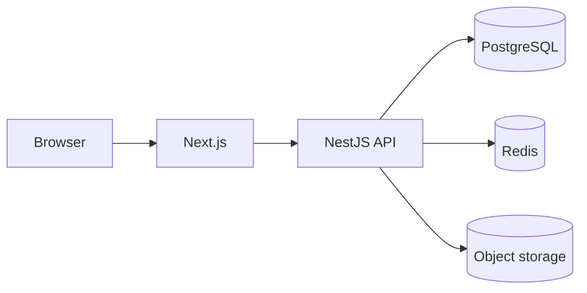

# Rentora architecture

## Monorepo layout

- `apps/web` — Next.js App Router frontend (SSR/SEO, tenant & owner UI)
- `apps/api` — NestJS REST API (`/api/v1`), Swagger at `/docs`
- `packages/shared` — Shared Zod schemas and enums
- `infrastructure` — Docker Compose for PostgreSQL, Redis, and MinIO (S3-compatible)
- `docs` — Architecture and feature notes

## Request flow

## Security model

- Argon2id password hashing
- Short-lived JWT access tokens (memory on client)
- HttpOnly refresh token cookie with rotation on `/auth/refresh`
- Role guards on backend routes (`TENANT`, `OWNER`, `ADMIN`)
- Property mutations verify `ownerId` server-side
- Rate limiting via `@nestjs/throttler`

## Data model

Normalized Prisma schema: users, profiles, properties, images, amenities, favourites, enquiries, visit requests, notifications, reports, audit logs, and auth token tables.

## Local development

1. Start infrastructure (or point `DATABASE_URL` at your PostgreSQL instance).
2. Run migrations and seed.
3. Start API and web dev servers.

See root `README.md` for commands.
